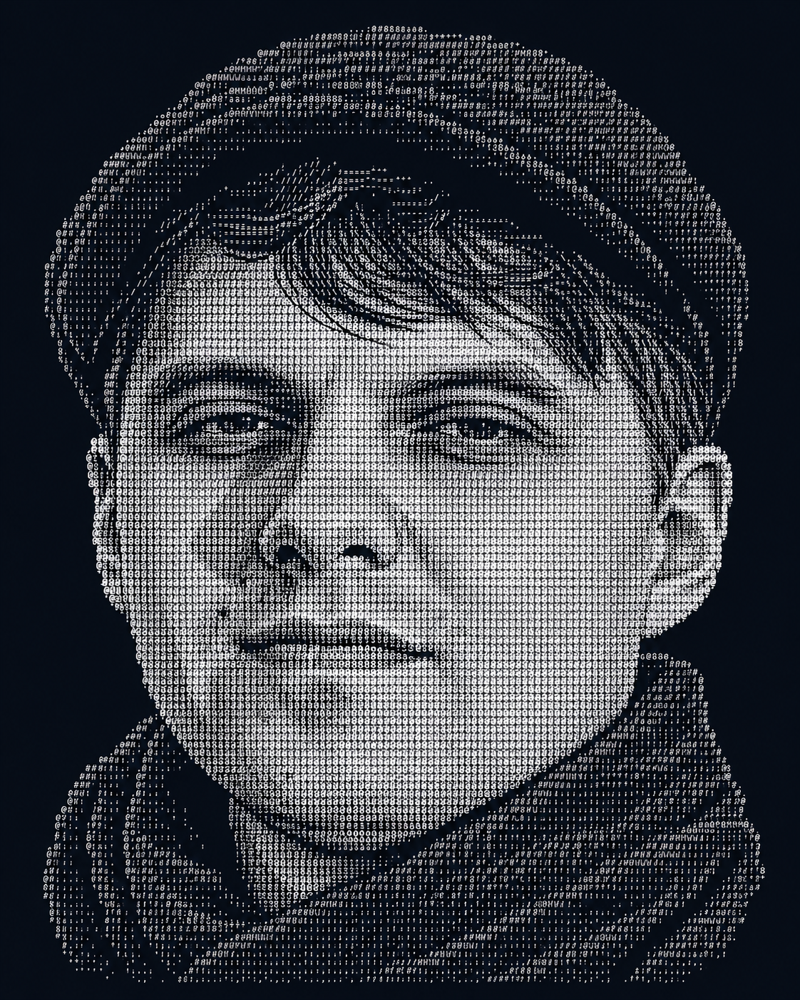
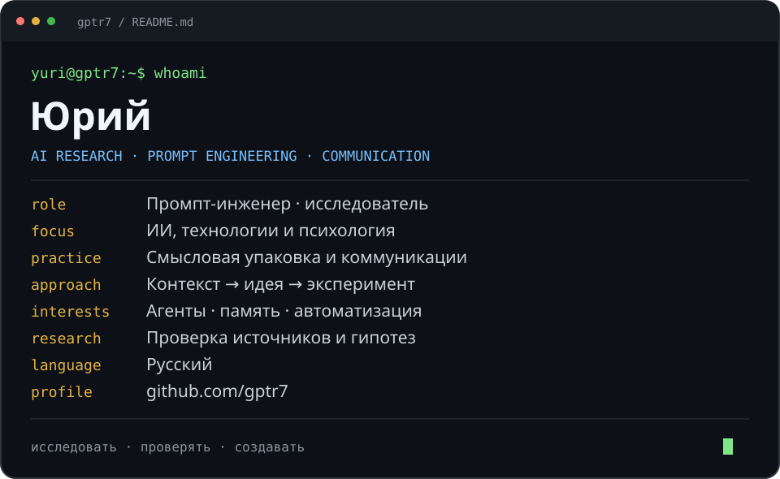

<!-- Public profile README for gptr7. -->

<table>
<tr>
<td width="34%" valign="middle">

</td>
<td width="66%" valign="middle">

</td>
</tr>
</table>

### Привет, я Юрий

Промпт-инженер и исследователь ИИ, технологий и психологии. Работаю со смысловой упаковкой, копирайтингом и коммуникационными стратегиями.

- **ИИ и исследования:** промпты, агентные сценарии, проверка источников и гипотез.
- **Коммуникации:** позиционирование, тексты и представление брендов.
- **Интересы:** персональные системы знаний, память, автоматизация и инструменты для мышления.

**Мой подход:** понять контекст → сформулировать задачу → проверить идею на практике.

Исследовать · проверять · создавать
